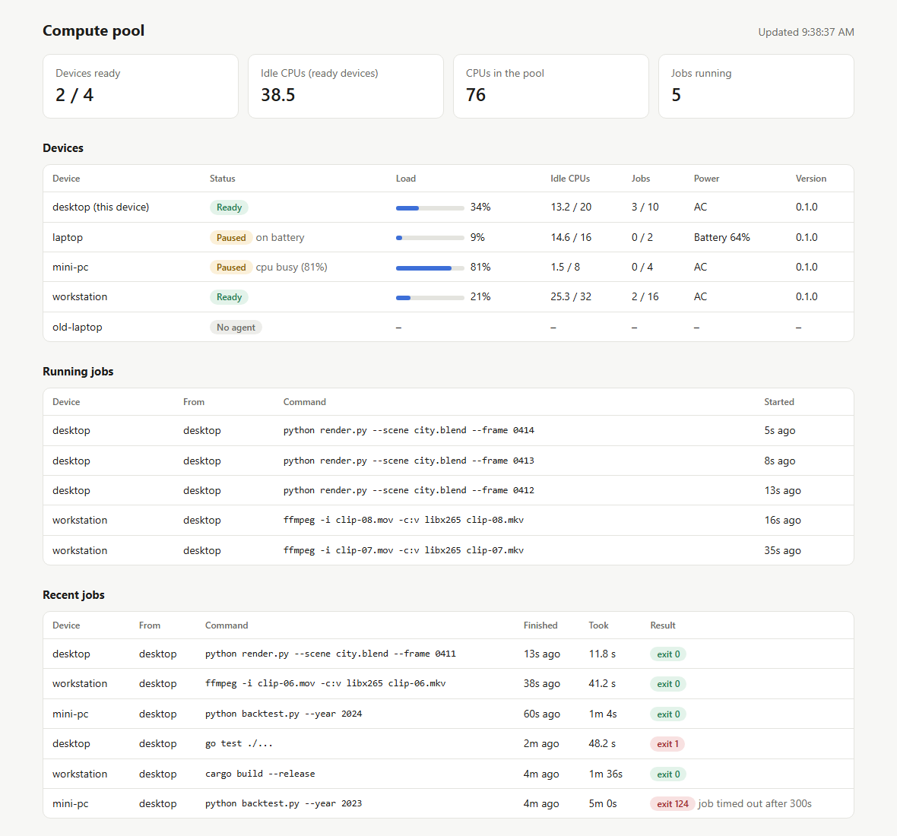

# compute-pool

Share CPU between your own devices over Tailscale. Each device runs an agent;
any allowed device can send it a command and get the output streamed back.

```
pool agent --allow desktop,laptop        # on each device that lends CPU
pool nodes                               # load, power and status of every device
pool run -- go test ./...                # run on the least-loaded device
pool run --node laptop -- go test ./...  # or pick the device yourself
pool map --inputs 'data/*.csv' --ship analyze.py --collect out -- python analyze.py {}
                                         # one task per file, spread over every device
```

<picture>
  <source media="(prefers-color-scheme: dark)" srcset="docs/images/dashboard-dark.png">
  
</picture>

Status: **v0.1.0**, early. Works on Windows (tested on two machines); Linux and
macOS build and pass the test suite in CI. See [SECURITY.md](SECURITY.md)
before running an agent.

## Install

Download the binary for your platform from
[Releases](https://github.com/montjeffrey/compute-pool/releases), verify it
against `SHA256SUMS`, rename it to `pool` (`pool.exe` on Windows) and put it on
your `PATH`. Release binaries are built by GitHub Actions from the tagged
commit. They aren't code-signed yet, so Windows may warn before running them, and
on a PC with Smart App Control turned on it may refuse to run them at all.
Smart App Control judges each file separately, so one release can run while the
next is blocked.

Releases after v0.1.0 also carry build provenance: a signed record that each
binary was built by this repository's release workflow. Check it with the
GitHub CLI:

```bash
gh attestation verify pool-0.2.0-windows-amd64.exe --repo montjeffrey/compute-pool
```

Commits and release tags are signed, and show as **Verified** on GitHub.

## Splitting work with `pool map`

`pool map` runs one task per item, using every free job slot on every device.
Choose the items with exactly one of:

| Flag | One task per… | `{}` becomes |
|---|---|---|
| `--range 1..100` | number | the number |
| `--items list.txt` (or `-` for stdin) | non-empty line | the line |
| `--inputs 'data/*.csv'` | matching local file (shipped with its task) | the file's name |

`{#}` becomes the task number. Each task also gets `POOL_TASK_INDEX` and
`POOL_TASK_ITEM` in its environment.

- `--ship FILE_OR_DIR` (repeatable) sends files with every task. A shipped
  program can be run by name: `--ship tool.exe -- tool.exe {}`.
- `--collect PATTERN` (repeatable) brings back matching files (a matching
  folder comes back whole) into `pool-out/<task#>/`.
- Output prints as one block per task; `--keep-order` prints in input order;
  `-v` adds a line per task showing where it ran and how long it took.
- If a device fails mid-task, the task is retried elsewhere (`--retries 2`).
  If a device pauses (battery, busy), its tasks go to the others.
- Near the end, slow tasks get a **backup copy** on a faster device; the first
  to finish wins and the other is canceled. Turn this off with
  `--speculate=false` for tasks that do more than produce output (send
  email, write to a shared database, and so on).
- Agents **cache shipped files** by SHA-256 (`--cache-mb 2048`), so a program
  shipped with 1,000 tasks crosses the network once per device, and later
  runs reuse it. Content is verified against its hash before it is cached.
  A shipped program runs as a hard link to its cached copy, which is
  re-verified before each use, so antivirus scans it once rather than once per
  task (Windows Defender adds about half a second to each new copy of a
  program). Other shipped files are copied, so a task can't change another
  task's input.

Paths are checked on both sides: inputs and collected files can't use `..`,
absolute paths, drive letters, Windows device names (`CON`, `NUL`, …) or
control characters, and a matched symbolic link is skipped rather than
followed. The client never writes a returned file through an existing link.
Limits per task: about 180 MiB and 10,000 shipped files; 256 MiB and 10,000
collected files; 16 MiB of buffered output each for stdout and stderr in
`pool map`.

### Measured speedup

`scripts/bench.ps1` runs the same CPU-bound tasks (`cmd/poolbench`, ~1.75s each
on the desktop) on one device and on all devices:

| Setup | 1 device | 2 devices | Speedup |
|---|---|---|---|
| desktop (10 slots) + laptop lending **2** slots, 48 tasks | 10.5s | 9.5s | 1.10× |
| desktop (10 slots) + laptop lending **8** slots, 96 tasks | 18.5s | 14.1s | **1.31×** |

The laptop's tasks slow from ~2.3s to ~3.1s when it runs 8 at once, so the
best possible result for the second setup is about 1.45× (desktop ~5.9
tasks/s, laptop ~2.6 tasks/s); the pool gets ~90% of it, and the laptop does
a third of the work. Lending only 2 laptop slots adds ~15% capacity, so
pooling pays off once a device lends a meaningful share of its cores. It also
pays off more for longer tasks, since the fixed cost of a run (~1s to start)
and of each task (~0.1s) matters less.

**Windows Smart App Control:** when it is on, Windows may refuse to start
unsigned programs that were just shipped to a device ("An Application Control
policy has blocked this file"). Shipping scripts to an installed interpreter
(`--ship job.py -- python job.py`) avoids this.

## How placement works

Every agent samples its CPU load every 2 seconds and checks its power source.
It **pauses** (refuses new jobs, with a reason) when:

- the device is **on battery**, unless started with `--lend-on-battery`;
- CPU use is at or above `--busy-threshold` (default 80%), whether from the
  owner's own work or from jobs already running;
- all `--max-jobs` slots are taken.

`pool run` without `--node` asks every agent for its status, ranks the ready
ones by **idle CPUs** (then by free job slots), and sends the job to the best
one. If that agent declines in the meantime, the next one is tried. When no
device can take the job, the error lists why for each device.

```
DEVICE                 OS             CPUS  IDLE  LOAD  JOBS  POWER        STATUS
desktop (this device)  windows/amd64  20    17.2  14%   0/10  AC           ready
laptop                 windows/amd64  16    13.4  16%   0/2   battery 65%  paused: on battery
```

Owner activity is judged from total CPU load, not keyboard or mouse input:
an agent started over SSH or as a service can't see the desktop session's input.
Jobs already running are not paused; they keep below-normal priority.

## How it stays safe

An agent runs whatever an allowed device sends it, as the user the agent runs
as. Deciding who is allowed is therefore the whole job, and it is done in
layers:

- The agent listens **only on the device's Tailscale address**, never on LAN or
  public interfaces (unless you pass `--listen`, which logs a warning).
- Every request is identified with `tailscale whois`. A caller must be **owned by
  the same Tailscale user** *and* be **named in `--allow`**. Addresses outside
  Tailscale's ranges are refused before any lookup. Anything else gets 403.
- **Web pages can't reach it.** Requests carrying browser headers (`Origin`,
  cross-site `Sec-Fetch-Site`) are refused, jobs must be sent as JSON (which a
  page can't do without a preflight the agent never answers), and the Host header
  must name the agent, which stops DNS rebinding.
- The client only sends jobs, files and `--env` values to **devices you own**,
  so a device shared into your tailnet can't pose as an idle agent to receive them.
- Traffic is encrypted by Tailscale's WireGuard tunnel.
- Jobs run at **below-normal priority** in a fresh scratch folder (deleted
  afterwards). Canceling (Ctrl+C) or `--timeout` kills the **whole process tree**.

[SECURITY.md](SECURITY.md) has the full threat model, the known limits, and how
to report a vulnerability.

## Build

Requires Go 1.24+ and Tailscale signed in on every device.

```powershell
go build -trimpath -o bin/pool.exe ./cmd/pool
go test ./...
```

`-trimpath` keeps your local folder paths out of the binary; use it for anything
you share. Cross-compile for other devices:
`$env:GOOS='linux'; go build -trimpath -o bin/pool-linux ./cmd/pool`.

## Set up a device

1. Copy `bin/pool.exe` to the device (Go isn't needed there).
2. Install the agent so it starts by itself (same flags as `pool agent`).
   On a laptop, lend only part of the CPU:
   ```powershell
   pool install --allow desktop --max-jobs 2
   ```
3. From another device: `pool nodes` should list it as `ready`.

If Windows Firewall blocks inbound connections on that device, allow them
from the tailnet only, in an **admin** PowerShell:
```powershell
New-NetFirewallRule -DisplayName "compute-pool agent" -Direction Inbound -Action Allow `
  -Program "$env:LOCALAPPDATA\compute-pool\bin\pool.exe" -Protocol TCP -LocalPort 7470 -RemoteAddress 100.64.0.0/10
```

### Running in the background (`pool install`)

`pool install` copies `pool.exe` to `%LOCALAPPDATA%\compute-pool\bin` and
registers a Task Scheduler task, **"compute-pool agent"**, that runs it as you,
never as SYSTEM, and stores no password:

- From an elevated shell it runs **at startup**, before anyone logs in, with no window.
  Otherwise it runs **at logon** (a console window flashes once and hides).
- A watchdog trigger relaunches the agent within a minute if it dies.
  Task Scheduler's own restart-on-failure only covers launch failures.
- It keeps running on battery; the agent's own policy decides whether to lend CPU.
- The log is `%LOCALAPPDATA%\compute-pool\agent.log` (rotated at 10 MB).
- Re-run `pool install` to upgrade or change flags; `pool uninstall` removes it.

The agent waits for Tailscale instead of exiting when it isn't up yet (at boot,
or after waking). It checks its own listener every 30 seconds and binds again if
sleep or a network change broke it. On Windows, every job runs inside a job
object tied to the agent, so if the agent is stopped or crashes, its jobs end too.

On Linux or macOS, run `pool agent --log-file ...` from a systemd user service or
a launchd agent; `pool install` is Windows-only so far.

### Dashboard (`pool dashboard`)

`pool dashboard --open` serves a live view of every device (status, load, idle
CPUs, job slots, power) and of running and recent jobs. It refreshes every
2 seconds. By default it listens on `127.0.0.1:7471`, reachable only from this
device, and rejects requests whose Host header doesn't match, which blocks
DNS-rebinding attacks. `--tailnet --allow phone,laptop` serves it on the
Tailscale address so those devices can open it, with the same identity check
the agents use.

## Command reference

| Command | Flags |
|---|---|
| `pool agent` | `--allow a,b` devices that may submit jobs (this device is always allowed) · `--max-jobs N` (default: half the logical CPUs) · `--lend-on-battery` · `--busy-threshold 80` (0 = never pause) · `--cache-mb 2048` · `--port 7470` · `--work-dir` · `--listen` |
| `pool run [--node N] -- cmd args...` | `--node auto` (default) or a device name/IP · `--shell` run via cmd.exe or /bin/sh · `--ship` · `--collect` · `--out pool-out` · `--timeout 10m` · `--env K=V` (repeatable) · `-v` shows where the job went · `--probe-timeout 1s` |
| `pool map (--range A..B \| --items F \| --inputs GLOB) -- cmd {}` | `--ship` · `--collect` · `--out pool-out` · `--nodes a,b` · `--jobs N` · `--retries 2` · `--speculate` · `--keep-order` · `--shell` · `--timeout` · `--env K=V` · `-v` |
| `pool nodes` | `--timeout 1s` |
| `pool dashboard` | `--open` · `--listen 127.0.0.1:7471` · `--tailnet` · `--allow a,b` |
| `pool install` / `pool uninstall` | `pool install` takes the same flags as `pool agent` (Windows) |

`pool run` exits with the remote program's exit code. The agent itself reports
127 (couldn't start), 124 (timed out) and 130 (canceled).
Jobs see `POOL_JOB_ID` and `POOL_NODE` in their environment.

## Development

Work happens on branches merged into `main` through pull requests. CI
(`.github/workflows/ci.yml`) checks formatting, runs `go vet`, runs the tests
on Windows, Linux and macOS (with the race detector on Linux), and runs
`govulncheck`. `scripts/bench.ps1` measures speedup on real devices.

To see the dashboard without any devices, serve it with made-up data (this is
what the screenshot shows):

```bash
POOL_DEMO_DASHBOARD=127.0.0.1:7472 go test ./cmd/pool -run TestDemoDashboard -timeout 0
```

Releases: pushing a tag such as `v0.2.0` runs `.github/workflows/release.yml`,
which tests the tagged commit, builds binaries for Windows, Linux and macOS
(x64 and Arm) with the version stamped in, and publishes them with checksums,
build provenance attestations and the notes in `docs/releases/<tag>.md`. Tag
releases with `git tag -s` so the tag is signed.

## License

[MIT](LICENSE).

## Roadmap and test plan

| Milestone | Scope | How it's verified |
|---|---|---|
| **1. Remote run** ✅ | `pool run` on a named device, streaming, cancel/timeout, allow list | Unit + end-to-end tests (`go test ./...`), live run over Tailscale |
| **2. Scheduling** ✅ | Pick the least-loaded device automatically; laptops lend CPU only on AC power; pause when CPU is busy | Unit tests for ranking, power and load parsing, and agent policy; live: laptop on battery paused itself, busy desktop → job auto-placed on laptop |
| **3. Fan-out** ✅ | `pool map` across devices; ship and collect files; content cache; retry on device failure; backup copies of slow tasks | Unit tests for scheduling, retries, backups, cache, path safety; live benchmark 1.31× (90% of the possible 1.45× for these two machines) |
| **4. Hardening** ✅ | Runs in the background and restarts itself; survives sleep and network changes; jobs die with the agent; `pool run` moves past unreachable devices; dashboard | Unit tests for job history, unreachable agents, log rotation, health check, dashboard state and Host check, task argument quoting; live on both devices: agents killed → both back within 56s; agent killed mid-job → job process gone |
